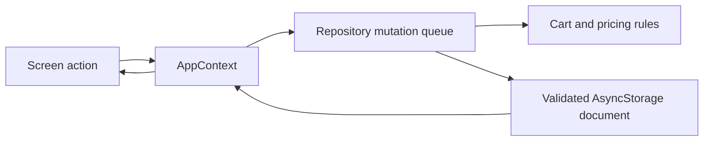

# Coffee Bliss architecture

Coffee Bliss is a single Expo application backed by local AsyncStorage. Shared rules keep the menu, cart, checkout, and receipts consistent. The implementation follows the [gstack reuse and scope principles](https://github.com/garrytan/gstack/blob/main/agents-digest/gstack-AGENTS.md), using the libraries already needed by this project.

## Data flow

Screens own temporary input. AppContext owns the last confirmed saved state and reports pending operations and failures. The repository serializes mutations, reads the latest document, applies a command, validates the result, and saves before publishing it to the UI. A rejected operation does not stop later queued operations.

## Records

The `cb_state_v2` document contains a schema version, revision, ID counters, selected profile ID, profiles, carts, orders, and an optional migration notice. Profile and order IDs come from persisted counters. Names and email punctuation never determine storage keys.

Each cart has a revision and lines. A line contains a product ID, normalized selection, quantity, and a deterministic ID built from its configuration. Toppings are sorted and deduplicated before calculating identity. Editing removes the source by ID before locating a merge target. All quantity changes enforce the same 1–99 limit.

Prices come from the current menu and option configuration. Integer cents are used throughout. GST is `Math.round(subtotalCents * 15 / 100)`. Cart totals are derived; order snapshots retain their captured product names, options, quantities, unit prices, totals, and timestamp. Historical receipts are independent of subsequent menu price edits.

## Checkout and navigation

A checkout request uses the profile ID and cart revision as its identity. The repository first looks for an existing order for that request, then checks the current cart revision. One document write records the order and clears the cart. A retry returns the saved order instead of creating a duplicate.

Menu, Cart, Orders, and Profile live inside Tabs. Customization, checkout, and receipts live in the parent stack. Root screens use one `returnToTab` helper to pop to the existing Tabs route and select a tab. Success and receipt use the same saved-order screen.

## Failure handling

Malformed or unsupported saved documents open a recovery screen instead of being overwritten. Read failures can be retried. Reset first saves the previous document to `cb_state_v2_backup`; failure to create that backup prevents the reset. Shared confirmation dialogs and error feedback work on web and native.

Legacy import reads the old profile and order formats, discards password fields from the new document, preserves original keys, and reports skipped or shared records. Stored amounts on old receipts are retained, including their original rounding.

## Boundaries

One small document suits the local course project. AsyncStorage is not a transactional database, and the queue coordinates one active app instance. It does not coordinate several browser tabs or devices. Profiles provide local organization rather than verified identity. Orders are stored locally without payment or external fulfillment. A real shared ordering service would require a separate backend design.

## Dependency maintenance

Expo stays on SDK 58 with compatible native patch versions. The scoped `minimatch` override supplies the security fix for GHSA-g3hv-75wg-m249 inside `@expo/fingerprint`, whose published dependency range still selects the affected version. Keep the override until the upstream range includes the fix. Its path matching and fingerprint generation must be checked when updating this dependency.
